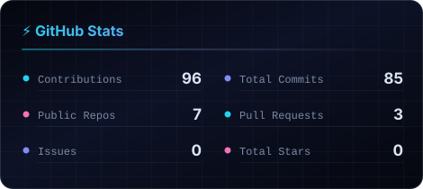

<!--
  ─────────────────────────────────────────────────────────────
  GitHub Profile README — github.com/kasra-nikshabani
  Lives in the repo kasra-nikshabani/kasra-nikshabani (branch: main)
  ─────────────────────────────────────────────────────────────
-->

<div align="center">
  
</div>

<div align="center">

[](https://www.linkedin.com/in/kasra-nikshabani/)
[](mailto:kasranikshabani@yahoo.com)


</div>


## 🧭 About

```js
const kasra = {
  role:     "Team Lead · Full-Stack Developer",
  at:       "Foolad Mobarakeh Sepahan Club",
  from:     "Isfahan, Iran 🇮🇷",
  frontend: ["TypeScript", "React.js", "Next.js", "JavaScript"],
  backend:  ["Java", "Spring Boot", "C#", "ASP.NET Core"],
  focus:    ["Software architecture", "RESTful APIs", "Microservices"],
  motto:    "Build it simple, make it work, then make it good.",
};
```

- 💼 &nbsp;**Team Lead** of software development at **Foolad Mobarakeh Sepahan Club** — club systems, e-commerce, academy platform, and internal automation.
- 🧩 &nbsp;Backend with **Java / Spring Boot** and **C# / ASP.NET Core**; frontend with **React.js** and **Next.js**.
- 🏗️ &nbsp;Hands-on with **software architecture**, **RESTful APIs**, databases, and shipping products that stay maintainable at scale.
- 🎫 &nbsp;Previously shipped Sepahan’s **online match ticketing** and fan entry app — [ticket.sepahansc.com](https://ticket.sepahansc.com/matches).
- 🤝 &nbsp;Open to collaborating on open-source — especially full-stack web apps and developer tooling.
- 📫 &nbsp;Reach me at **kasranikshabani@yahoo.com**


## 🛠️ Tech Stack

<table>
<tr>
<td valign="top" width="50%">

**Languages**


**Frontend**


</td>
<td valign="top" width="50%">

**Backend & Data**


**Tools**


</td>
</tr>
</table>

**Also in the toolkit:** REST APIs · Microservices · NoSQL · Celery · Software architecture

**📖 Currently leveling up**


<sub>Anisa Java Spring Developer · Microsoft Full-Stack Developer Professional Certificate</sub>


## 💼 Experience

| Role | Where | Highlights |
| :-- | :-- | :-- |
| **Team Lead — Software Development** | Foolad Mobarakeh Sepahan Club · *now* | Organizational software, online shop, [academy platform](https://academy.sepahansc.com), admin automation |
| **Senior Developer** | Sepahan Club | Online match ticketing + fan entry — [ticket.sepahansc.com](https://ticket.sepahansc.com/matches) |
| **Software Engineer** | Basa Foolad Mobarakeh | Company web/app, digital wallet, banking scan systems, core performance work |
| **Developer** | APA · Cybersecurity Research Center | Secure systems, R&D, CDR — [cert.iut.ac.ir](https://cert.iut.ac.ir/fa) |
| **Software Specialist** | Danesh Bonyan Eftekhar Modiran | Psychology assessment platform — [eftekhartalent.ir](https://eftekhartalent.ir) |
| **Software Specialist** | Reyhaneh Gostar | Installment purchase system, banking switch APIs, company web/app |


## 📊 GitHub Analytics

<div align="center">

<!-- Self-hosted cards, regenerated every 6h by .github/workflows/stats.yml -->



<picture>
  <source media="(prefers-color-scheme: dark)" srcset="https://streak-stats.demolab.com?user=kasra-nikshabani&hide_border=true&background=0D1117&ring=22d3ee&fire=f472b6&currStreakLabel=818cf8&sideLabels=c9d1d9&dates=8b949e&currStreakNum=c9d1d9&sideNums=c9d1d9" />
  
</picture>

</div>

### 📈 Contribution Activity

<div align="center">
  <picture>
    <source media="(prefers-color-scheme: dark)" srcset="https://github-readme-activity-graph.vercel.app/graph?username=kasra-nikshabani&bg_color=0d1117&color=c9d1d9&line=22d3ee&point=f472b6&area_color=818cf8&area=true&hide_border=true&custom_title=Contributions%20—%20last%2031%20days" />
    
  </picture>
</div>

### 🐍 Contribution Snake

<div align="center">
  <picture>
    <source media="(prefers-color-scheme: dark)" srcset="https://raw.githubusercontent.com/kasra-nikshabani/kasra-nikshabani/output/snake-dark.svg" />
    
  </picture>
</div>


## 🚀 Projects

| Project | What it is | Built with |
| :-- | :-- | :-- |
| **[Sepahan Ticketing](https://ticket.sepahansc.com/matches)** | Online match tickets + fan entry for Foolad Mobarakeh Sepahan | Full-stack |
| **[Sepahan Academy](https://academy.sepahansc.com)** | Club academy / training platform | Full-stack |
| **[sepahanticket](https://github.com/kasra-nikshabani/sepahanticket)** | Ticketing front-end for Sepahan football club | `HTML` `CSS` `JS` |
| **[museum_sepahan](https://github.com/kasra-nikshabani/museum_sepahan)** | Web presence for the Sepahan club museum | `HTML` `CSS` |
| **[regex-validator](https://github.com/kasra-nikshabani/regex-validator)** | Email and phone-number validation utility | `Java` |

<details>
<summary><b>📂 How I work</b></summary>

<br>

| Principle | What it means in practice |
| :-- | :-- |
| **Ship small, ship often** | One branch per unit of work, small reviewable commits |
| **Readable > clever** | Code is read far more often than it's written |
| **Understand before copying** | I'd rather write 10 lines I understand than paste 100 I don't |
| **Finish what I start** | A working small feature beats an unfinished big one |

```bash
❯ git switch -c feat/thing      # branch per unit of work
❯ npm test && npm run lint      # green locally before pushing
❯ gh pr create --fill           # small, reviewable diffs
```

</details>


<div align="center">

**Thanks for stopping by — let's build something.** ⚡

<sub>⭐ Star anything you find useful.</sub>

</div>
